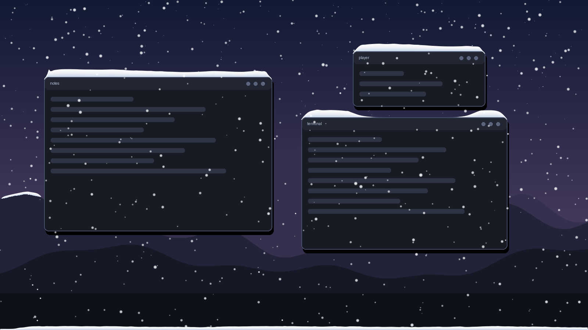
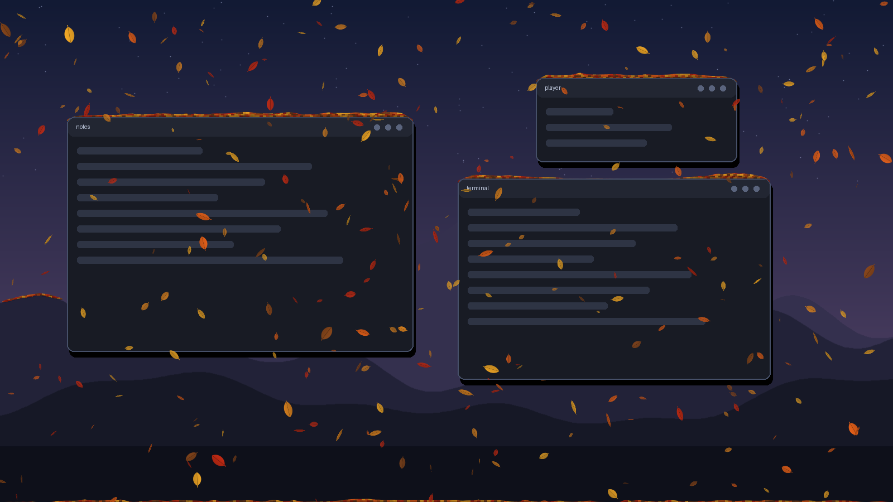
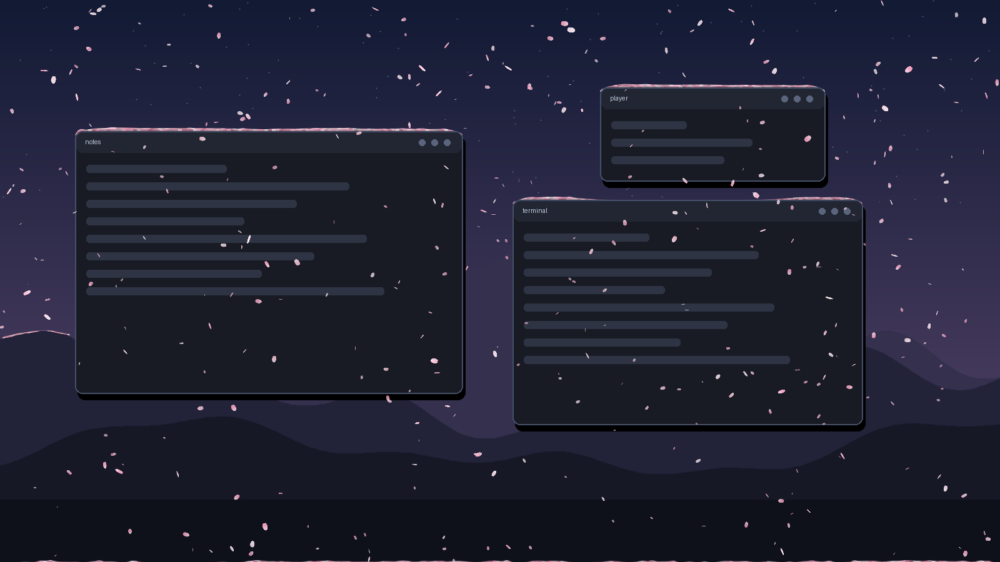
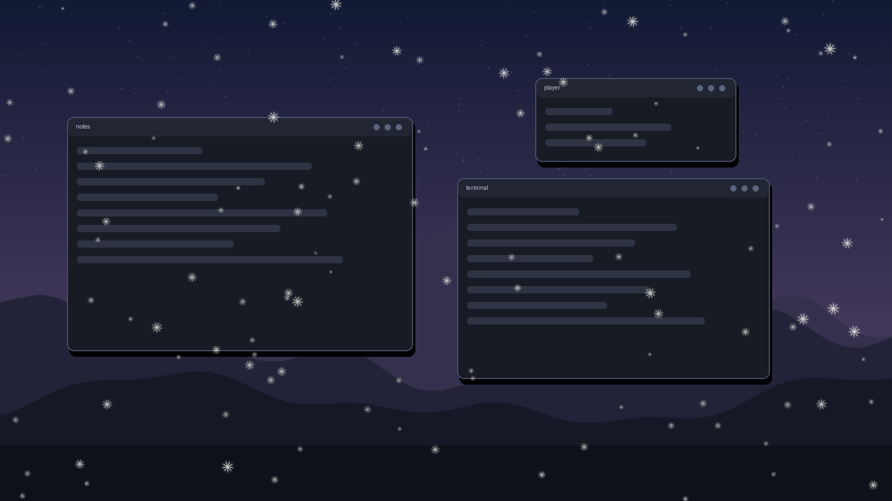

# seasoning

The season falls on your desktop and piles up on your windows.

Snow in winter, tumbling leaves in fall, blossom petals in spring and drifting
dandelion fluff in summer. It falls over everything and settles on the tops of your
windows, around their rounded corners, and even on the edges it finds in your
wallpaper (rooftops, ridgelines, the horizon). Move a window and its snow falls off.
Sweep the cursor through a pile and you plow a trench.

| winter | fall |
|---|---|
|  |  |
| **spring** | **summer** |
|  |  |

Runs on **Windows 10/11** and on **Linux with Hyprland**. It's click-through, renders
on the GPU, and uses a few percent of one CPU core.

Inspired by [Snowy](https://snowy.aauburn.com) by Archie, an open-source snow app for macOS.

## Features

- **Seasons that follow the calendar** (meteorological, northern hemisphere). You can also pin one season.
- **Piles on every visible window**, shaped by the window's rounded corners. Windows stacked on top hide and shelter the ones below.
- **Wallpaper edges**: it finds near-horizontal edges in your wallpaper and lets snow settle on them. This works with any image: flat or abstract wallpapers just get no ledges.
- **Physics**: snow slumps to a natural angle, the wind drifts it along a pile and blows it off the ends, and settled snow keeps the shape you carve into it.
- **Wind**: set direction and strength on a wind pad. It changes where snow lands and how piles drift.
- **Cursor**: flakes swirl in the cursor's wake, and dragging through a pile plows it.
- **Moving windows**: a window that moves, closes or leaves the screen drops its snow. On Hyprland, switching workspaces leaves the snow hanging in place while the window slides out from under it.
- **Gets out of the way**: it hides itself while a game or video is fullscreen.

## Windows

Download `seasoning.exe` from the [latest release](../../releases/latest) and run it.
A snowflake appears in the tray. Right-click it for the season, amount, pause,
clearing piles, the wallpaper-edges and bottom-pile toggles, and **Start with Windows**.
**Controls…** opens the wind pad.

Needs a GPU with OpenGL 3.3, which is any graphics driver from the last decade.

## Linux (Hyprland)

```sh
# Arch:   sudo pacman -S python-gobject gtk4 gtk4-layer-shell python-numpy python-pillow grim
git clone https://github.com/TheRealSamkoThatsReal/seasoning
cd seasoning && ./install.sh
seasoning start
```

`install.sh` checks dependencies and puts a `seasoning` launcher in `~/.local/bin`.
`grim` is optional: with it, ledges hidden under your bar or dock are skipped.

Keybinds, Lua config (Hyprland 0.56+):

```lua
hl.on("hyprland.start", function() hl.exec_cmd("seasoning start") end)
hl.bind("SUPER + N", hl.dsp.exec_cmd("seasoning toggle"))
hl.bind("SUPER + SHIFT + N", hl.dsp.exec_cmd("seasoning panel"))
hl.window_rule({ name = "seasoning-panel", match = { class = "^seasoning\\.panel$" }, float = true, pin = true })
```

Older `hyprland.conf` configs:

```ini
exec-once = seasoning start
bind = SUPER, N, exec, seasoning toggle
bind = SUPER SHIFT, N, exec, seasoning panel
windowrule = float, class:^(seasoning\.panel)$
```

Wallpaper edges are read from `awww`, `swww` or `hyprpaper`.

## Commands

The same commands work on both platforms while the overlay is running:

```
seasoning season winter|spring|summer|fall|auto
seasoning wind 180 40        # blow toward 180° (west) at 40%
seasoning intensity 1.5      # 0-3
seasoning stick 0.35         # share of flakes that land on windows (the rest fall past)
seasoning pause | clear | floor | ledges | rescan | quit | status
seasoning ledges show        # save a picture of the edges found in your wallpaper
```

Settings persist in `~/.config/seasoning/state.json` on Linux or `%APPDATA%\seasoning\state.json` on Windows.

## How it works

One shared core (`seasoning/core.py`) runs the simulation in numpy and draws it with
OpenGL shaders:

- **Particles:** one point-sprite draw call. The shader draws each sprite as a flake, leaf, petal or seed.
- **Piles:** a height map per surface, drawn as a triangle strip.
- **Wallpaper edges:** found by gradient thinning and line tracing at quarter resolution.

The two platform layers just answer "where are the windows, the cursor and the wallpaper":

- **`hyprland.py`:** a GTK4 layer-shell overlay that reads Hyprland's IPC socket.
- **`windows.py`:** a transparent, click-through GLFW window using `EnumWindows` (in stacking order) and DWM frame bounds. Windows on other virtual desktops are recognised by their cloaked state.

```sh
python -m pytest tests     # headless simulation tests, no display needed
```

## Limitations

- **One monitor:** it uses the primary monitor.
- **Windows virtual desktops:** switching drops each window's snow at once, rather than the per-column slide on Hyprland.
- **ChromeOS isn't supported.** Linux apps there run in a container that can't draw over other windows, make itself click-through, or see where your windows are. A browser extension could do snow over web pages, but that would be a different project.

## License

MIT
